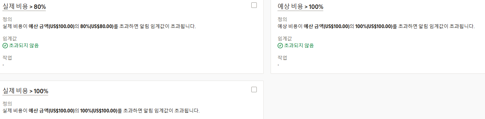
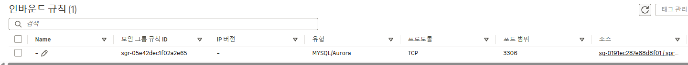

# ☁️ AWS Cloud 아키텍처 설계 및 배포

---

AWS 기반의 클라우드 인프라를 설계하고 Spring Boot 애플리케이션을 배포하는 실습 프로젝트!

#### 기능 구현 과정: [Notion](https://bolder-shrimp-6f4.notion.site/_-417df7a8441c80f389b6d4355f69498f?pvs=73)

#### 프로젝트 기록: [Velog](https://velog.io/@juhan913/posts)

---

### Level 0. AWS Budget 설정

---

### Level 1. VPC 설계 + EC2 배포

**EC2 퍼블릭 IP**: 43.203.254.146

로컬 실행:

EC2에서 실행:

---

### Level 2. Actuator + RDS 보안 그룹 검증

- **Actuator Info 엔드포인트 URL**: http://43.203.254.146:8080/actuator/info

- **RDS 보안 그룹 인바운드 규칙**

    보안 그룹 체이닝 -> IP 주소를 직접 지정하는 대신, 특정 보안 그룹에 속한 서버(EC2)만 DB에 접근 가능 

---

